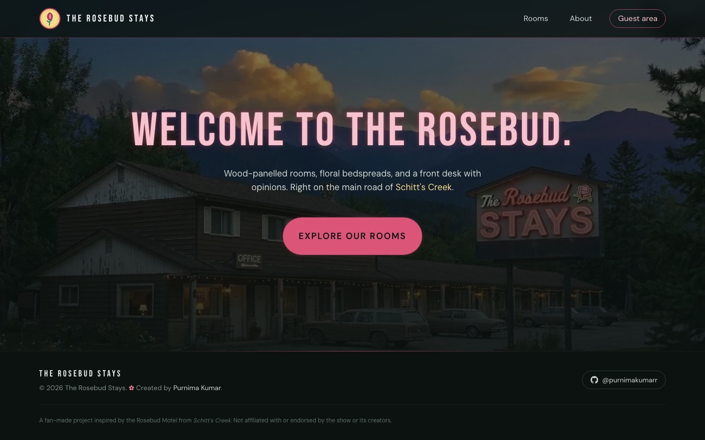
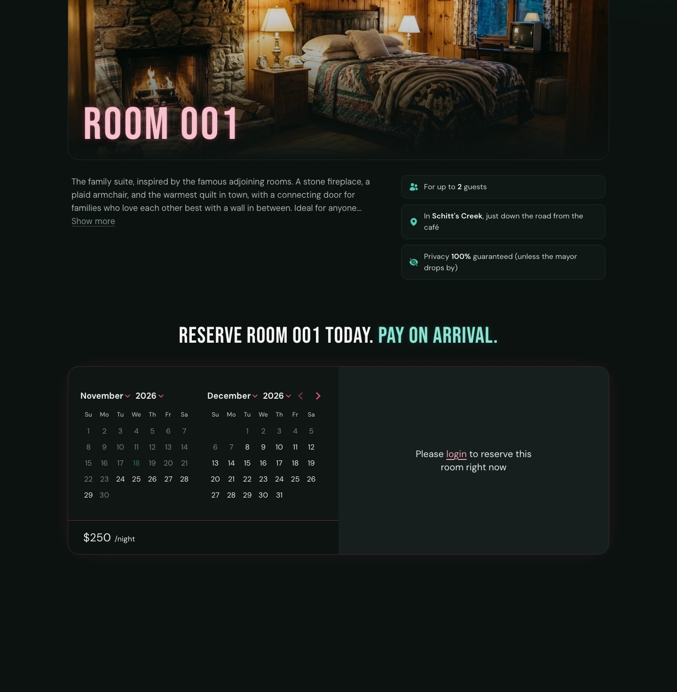

# The Rosebud Stays

A booking site for a small-town motel, inspired by the Rosebud Motel from _Schitt's Creek_. Guests can browse rooms, pick dates on a calendar, sign in with Google, reserve a stay, and manage their reservations and profile.

| Rooms                                | Room & booking calendar                                         |
| ------------------------------------ | --------------------------------------------------------------- |
|  |  |

On phones:

| Home                                                | Rooms                                                 | Room                                                |
| --------------------------------------------------- | ----------------------------------------------------- | --------------------------------------------------- |
|  |  |  |

## Built with

Next.js 14 (App Router, Server Components, Server Actions) · React 18 · Tailwind CSS · Supabase (Postgres) · Auth.js with Google sign-in · date-fns · react-day-picker · Vitest and Testing Library

## Interesting bits

**The server never trusts the browser with money or availability.** The booking form only sends the room and the dates. The server action reloads the room, the hotel settings and the booked dates, then checks the stay length, capacity and overlaps, and works out the price itself. Any price a tampered request adds is ignored. See [`createBooking`](app/_lib/actions.js).

**One set of booking rules for client and server.** [`booking-rules.js`](app/_lib/booking-rules.js) has no database access, so the calendar, the booking form and the server action all use the same functions, and they're unit tested on their own. The UI uses the rules to guide the guest; the server uses them to enforce.

**A race condition the app alone can't fix.** Check-then-insert lets two guests book the same nights if they submit at the same moment. A Postgres exclusion constraint makes the database reject the second booking, and the app turns that rejection into the same friendly "those nights were just booked" message.

**Access control in layers.** Middleware sends signed-out visitors on any `/account` page to sign in. Every action checks that the booking belongs to the guest and hasn't started yet. Someone else's reservation responds as "not found", so its existence isn't revealed.

**Friendly errors without leaking internals.** Problems a guest can fix (`UserError`) are shown as written: "This room sleeps between 1 and 4 guests…". Anything unexpected is logged on the server and replaced with a polite generic message. Forms show the result inline using `useFormState`, and cancelling a reservation updates the list instantly with `useOptimistic`, putting the card back if the request fails.

## Running it locally

1. `npm install`
2. Copy `.env.example` to `.env` and fill in your Supabase, Google OAuth and REST Countries keys.
3. `npm run dev` and open http://localhost:3000

`npm test` runs the test suite, `npm run lint` the linter.

## Credits

A fan-made project, not affiliated with or endorsed by _Schitt's Creek_ or its creators.

Created by Purnima Kumar · [@purnimakumarr](https://github.com/purnimakumarr)
